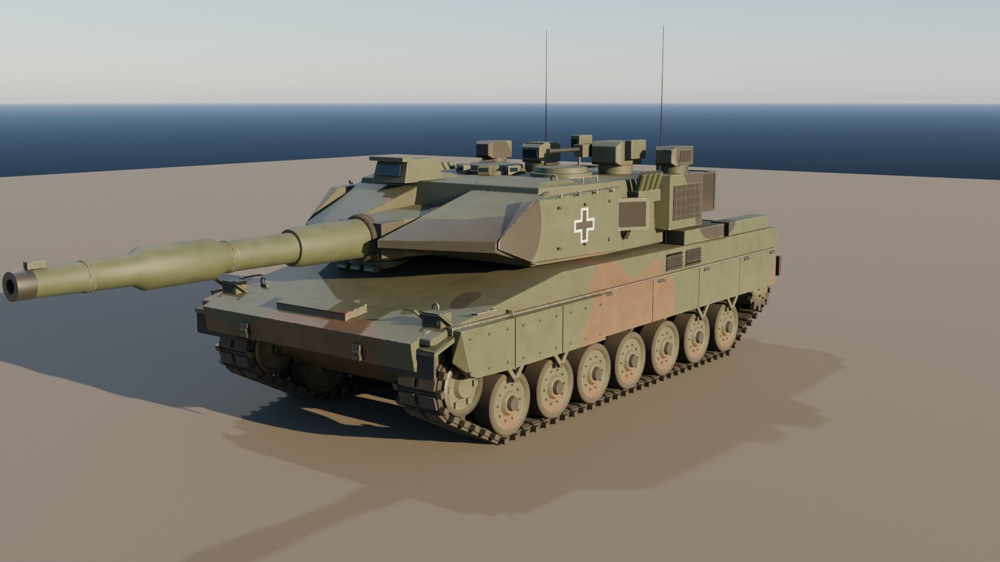
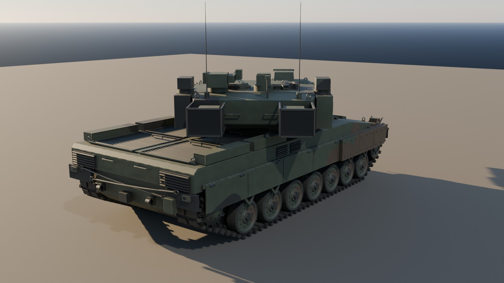
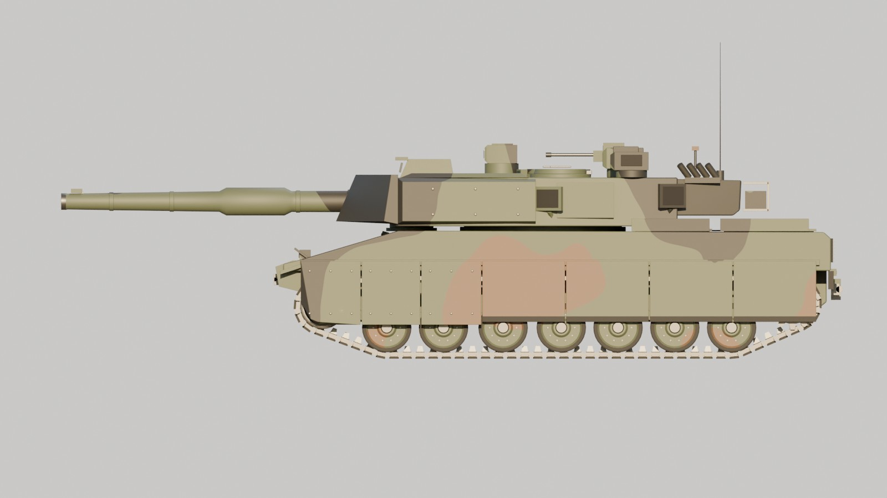

# Leopard 2A8 – Blender-Modell für Unreal Engine 5

Ein prozedural erzeugtes, geriggtes Echtzeit-Modell eines Leopard 2A8 als Blender-Python-Skript,
mit fertigen Exporten für UE5 (Skeletal Mesh, Nanite-taugliches Static Mesh, Kettenglied, Kettenpfad).





## Genauigkeit: was das Modell ist und was nicht

**Es ist kein CAD-genaues Modell.** Die Konstruktionsdaten des Leopard 2A8 gehören KNDS Deutschland und sind
zum Teil eingestuft. Aus öffentlichen Quellen lässt sich keine CAD-genaue Geometrie ableiten.

Das Modell hält sich an öffentlich bekannte Eckdaten und ist dazwischen nach Erscheinungsbild angenähert:

| Merkmal | Modell | öffentliche Angabe (ca.) |
|---|---|---|
| Länge, Rohr nach vorn | 11,02 m | ~10,97 m |
| Breite inkl. Schürzen | 3,79 m | ~3,77 m |
| Höhe (ohne Antennen, inkl. FLW 200) | 3,10 m | ~3,0 m |
| Bodenfreiheit | 0,52 m | ~0,49–0,54 m |
| Laufwerk | 7 Laufrollen Ø 700 mm, 4 Stützrollen, Triebrad hinten | wie Original |
| Kette | 635 mm breit, 86 Glieder je Seite | 635 mm |
| Kanone | Rh-120 L/55A1 (6,6 m) mit Rauchabsauger und Mündungsreferenzsystem | wie Original |

Alle Werte stehen am Anfang von `leopard2a8/build_leopard2a8.py` als Konstanten und lassen sich anpassen.
Die gemessenen Werte jedes Builds landen in `export/model_info.json`.

Proportionen wurden mit maßstäblichen Rissen (Leopard 2A6, Seite/Draufsicht/Front) per Overlay der
orthografischen Renderings abgeglichen: Laufrollenabstände, Trieb-/Leitrad, Wannen- und Deckhöhe,
Turmbreite und -länge, Keilform, Lukenpositionen, Rohrachse (~2,09 m), Blendenhülle und Staukörbe.
Details des 2A8 wurden zusätzlich mit Fotos abgeglichen (siehe [Referenzen](#referenzen)):
Schürzenhöhe (Laufrollen sichtbar), Lüftungsgitter in der Wannenseite, Trophy-Radarkästen an den
Turmseiten und Nebelwurfbecher-Block am Turm.

Angenäherte bzw. vereinfachte Bereiche: Turm- und Keilpanzerungsform, Sichtgeräte (EMES 15, PERI R17A3),
Waffenstation FLW 200, Trophy-Werfer und Radarpaneele, Motordeck, Heck, Schwingarme.

## Inhalt

```
leopard2a8/build_leopard2a8.py   Generator (Geometrie, UVs, Materialien, Rig, Export, Vorschau)
leopard2a8/bake_l2a8.py          Textur-Bake (Normal, AO, prozeduraler Lack/Abrieb/Schmutz -> PBR)
export/Leopard2A8.blend          Blender-Szene (Collections je Baugruppe, Rig, Kamera/Licht)
export/textures/                 PBR-Texturen je Texture-Set: BaseColor, Normal (DirectX), Normal_GL, ORM
export/SK_Leopard2A8.fbx         Skeletal Mesh für UE5 (41 Bones, Kettenband für UV-Panner)
export/SM_Leopard2A8.fbx         Static Mesh (Einzelkettenglieder) + UCX-Kollision, z. B. für Nanite
export/SM_Leopard2A8_TrackLink.fbx  einzelnes Kettenglied für Spline-/Instanz-Ketten
export/track_path_ue.json        Kettenmittellinie je Seite in UE-Koordinaten (cm) für Splines
export/model_info.json           gemessene Maße, Dreieckszahlen, Bone-Liste
renders/                         Vorschaubilder (Cycles)
```

Dreiecke: Wanne ~30k, Turm+Kanone ~26k, Laufwerk ~43k, Kettenband 4k (UE-Skeletal ≈ 104k);
Static Mesh mit Einzelgliedern ≈ 126k.

## Neu erzeugen

Voraussetzung: Blender ≥ 4.2 (getestet mit 5.2 LTS) oder das pip-Modul `bpy` (Python 3.13).

```bash
blender -b -P leopard2a8/build_leopard2a8.py -- --out export --renders renders
# oder
pip install bpy && python leopard2a8/build_leopard2a8.py --out export --renders renders
```

Optionen: `--no-export`, `--no-render`, `--samples N`. Ein Durchlauf ohne Rendern dauert etwa 5 Sekunden.
Das Skript lässt sich auch im Blender-Texteditor mit „Run Script“ ausführen.

Texturen backen (Cycles, CPU) mit `--bake`, dazu `--tex-size 2048` (Standard) und `--bake-samples 64`:

```bash
python leopard2a8/build_leopard2a8.py --out export --renders renders --bake --tex-size 2048
```

Mit 2048 px dauert das auf 4 CPU-Kernen etwa 20 Minuten, mit `--tex-size 1024` etwa 5 Minuten.

## Aufbau

**Koordinaten:** Blender +X = Front, +Y = links, +Z = oben, 1 Einheit = 1 m, Nullpunkt am Boden unter der
Wannenmitte. Der Export nutzt `FBX_SCALE_ALL`, damit das Fahrzeug in UE5 in cm ankommt, nach +X zeigt und
Skalierung 1,0 hat. Das Armature-Objekt heißt `Armature`, damit UE5 keinen zusätzlichen Root-Bone anlegt.

**Materialien = Texture-Sets** (für Substance Painter / UE5):

| Material | Inhalt |
|---|---|
| `MI_L2A8_Hull` | Wanne, Schürzen, Motordeck, Heck |
| `MI_L2A8_Turret` | Turm, Optiken, Luken, FLW 200, Trophy |
| `MI_L2A8_Gun` | Blende und Rohr |
| `MI_L2A8_RunningGear` | Lauf-, Stütz-, Leit- und Triebräder, Schwingarme |
| `MI_L2A8_Track` | Kette (Band bzw. Glieder) |
| `MI_L2A8_Optics` | Glasflächen |

Jede Gruppe hat ihren eigenen, überlappungsfreien UV-Atlas. Baugleiche Räder teilen sich die UVs der
jeweiligen Vorlage (höhere Texeldichte), alle Kettenglieder die UVs eines Glieds. Das Kettenband hat ein
eigenes Material `MI_L2A8_TrackBelt` mit einer Kachel pro Kettenglied. Die Oberflächenart (Lack, Stahl,
Gummi, dunkel, Glas) steckt zusätzlich als Vertex-Farbe `ColorID` im Mesh und dient in Substance Painter als
ID-Maske.

**Gebackene Texturen** (`export/textures/T_L2A8_<Set>_*.png`):

| Map | Inhalt | UE5-Einstellung |
|---|---|---|
| `BaseColor` | NATO-Dreifarbtarnung, Kantenabrieb (blankes Metall), Staub unten und in Vertiefungen, Balkenkreuz am Turm | sRGB |
| `Normal` | Schweißnähte an Plattenstößen, Walz-/Gussstruktur, Antirutschbelag auf waagerechten Flächen (DirectX, Grün invertiert) | Normalmap |
| `Normal_GL` | dieselbe Map im OpenGL-Format (für Blender) | – |
| `ORM` | R = Ambient Occlusion, G = Roughness, B = Metallic | sRGB aus, Masks |

Die Schweißnähte entstehen automatisch aus den scharfen Kanten von Wanne und Turm (High-Poly-Raupen, auf das
Low-Poly-Modell gebacken). Die Tarnung, der Abrieb und der Schmutz kommen aus einem prozeduralen Shader, der als
Emission in die Texturen gebacken wird. Damit sind sie in UE5 und in jedem anderen Programm identisch.

**Bones** (alle unter `root`):

| Bone | Zweck |
|---|---|
| `turret` | Turm-Seitenrichtung (Drehung um Z) |
| `gun` → `barrel` → `muzzle` | Höhenrichtung am Schildzapfen; `barrel` für den Rohrrücklauf; `muzzle` als Socket für Mündungsfeuer/Projektil |
| `coax` | Socket Koax-MG |
| `rws_yaw` → `rws_pitch` → `rws_muzzle` | Waffenstation FLW 200 |
| `hatch_commander`, `hatch_loader` | Turmluken (Gelenk an der hinteren Kante) |
| `trophy_l`, `trophy_r` | drehbare Trophy-Werfer |
| `wheel_[l/r]_01..07`, `idler_*`, `sprocket_*`, `roller_[l/r]_01..04` | Räder (Drehung um Y) |
| `exhaust_l`, `exhaust_r` | Sockets für Abgas-Partikel |

Alle Teile sind starr mit Gewicht 1,0 an genau einen Bone gebunden.

## Import in UE5

1. **Skeletal Mesh:** `SK_Leopard2A8.fbx` importieren mit *Skeletal Mesh* an, *Import Mesh* an,
   *Normal Import Method: Import Normals*, *Import Animations* aus, *Create Physics Asset* an,
   *Material Import Method: Create New Materials*, *Vertex Color Import Option: Replace*.
2. **Physics Asset:** Die automatisch erzeugten Körper auf eine Box für `root` (Wanne), eine für `turret`
   und eine Kapsel für `barrel` reduzieren. Für Räder Kugeln bzw. die Fahrzeugkomponente verwenden.
3. **Fahrzeug:** Eine Chaos-Vehicle-Komponente oder ein eigener Kettenantrieb kann `wheel_*`, `sprocket_*`,
   `idler_*` und `roller_*` direkt drehen. Turm und Kanone im Animation Blueprint über *Transform (Modify) Bone*
   steuern (`turret` Yaw, `gun` Pitch).
4. **Kette, Variante A (einfach):** Das Kettenband nutzt pro UV-Kachel in V genau ein Kettenglied. Ein
   Panner auf der V-Koordinate, gekoppelt an die Fahrgeschwindigkeit
   (`V-Offset = gefahrene Strecke / 18,33 cm`), lässt die Kette laufen. Als Textur eignet sich ein
   Normal/Height-Bake von `SM_Leopard2A8_TrackLink`.
5. **Kette, Variante B (detailliert):** `SM_Leopard2A8_TrackLink.fbx` importieren und mit den Punkten aus
   `track_path_ue.json` je Seite einen geschlossenen Spline aufbauen. Die Glieder per Instanced Static Mesh
   gleichmäßig verteilen (86 Glieder je Seite, Teilung 18,33 cm) und entlang des Splines verschieben.
   Die Punkte liegen bereits in UE-Koordinaten (cm, Y gespiegelt).
6. **Static Mesh / Nanite:** `SM_Leopard2A8.fbx` mit *Combine Meshes* importieren. Die `UCX_`-Hüllen werden
   automatisch zur Kollision. Nanite kann aktiviert werden (z. B. für Wracks oder Set-Dressing).
7. **Materialien:** Die FBX-Dateien verweisen relativ auf `textures/`; UE5 importiert BaseColor und Normal
   automatisch. Für das volle PBR-Setup ein Master-Material anlegen: `BaseColor` → Base Color,
   `Normal` → Normal (Textur als *Normal Map* komprimieren), `ORM` (sRGB aus, Compression *Masks*) mit R →
   Ambient Occlusion, G → Roughness, B → Metallic. Für das Kettenband zusätzlich einen Panner auf V
   (siehe Punkt 4).

## Bekannte Grenzen

- Schwingarme und Kettenband hängen am `root`-Bone. Bei echter Federung bewegen sich Räder, Arme und Kette
  nicht gemeinsam. Abhilfe: zusätzliche Federungs-Bones und Gewichte für das Kettenband.
- Die obere Kettenlinie liegt gerade auf den Stützrollen auf, es gibt keinen Durchhang.
- Es gibt kein Innenleben und keine LODs (UE5 kann LODs automatisch erzeugen; Nanite für das Static Mesh).
- Die Texturen sind prozedural, nicht von Hand bemalt: keine Beschriftungen, Nummernschilder oder gezielten
  Verschleißspuren. Für ein Hero-Asset empfiehlt sich ein Durchgang in Substance Painter auf Basis der
  vorhandenen UVs, der `ColorID`-Maske und der gebackenen Maps.
- In der Normal Map haben einige verdeckte Innenflächen (ineinandergesteckte Bauteile) falsche Farben;
  sichtbar ist das nicht.
- Alle Details sind angenähert (siehe oben). Für Nahaufnahmen empfiehlt sich eine Nachmodellierung nach Fotos.

## Genauer werden

1. **Referenzen:** maßstäbliche Risszeichnungen (Fachliteratur, Modellbau-Pläne) als Hintergrundbilder
   einrichten und die Konstanten im Skript daran ausrichten.
2. **Fotogrammetrie / Laserscan:** an einem zugänglichen Fahrzeug, z. B. bei einem Museum, Tag der offenen
   Tür oder mit Genehmigung der Bundeswehr bzw. eines Nutzerstaats.
3. **Lizenzierte Daten:** Für ein kommerzielles Projekt ist eine Anfrage bei KNDS der einzige Weg zu
   herstellernahen Daten.

## Referenzen

Für den Maßabgleich wurden maßstäbliche Risszeichnungen des Leopard 2A6 (Seite, Draufsicht, Front/Heck)
genutzt, für 2A8-Details Fotos aus Wikimedia Commons. Keine dieser Vorlagen ist im Repository enthalten;
Urheber und Lizenzen der Fotos stehen auf den jeweiligen Dateiseiten:

- [Category:Leopard 2A8](https://commons.wikimedia.org/wiki/Category:Leopard_2A8) und
  [Category:Leopard 2A8 prototypes](https://commons.wikimedia.org/wiki/Category:Leopard_2A8_prototypes)
  (u. a. Seitenansicht auf Tieflader, Eurosatory-Aufnahmen von Bug, Turmseite und Laufwerk)

## Rechtlicher Hinweis

„Leopard“ und das Fahrzeugdesign können marken- und designrechtlich geschützt sein. Für private und
nicht-kommerzielle Projekte ist das in der Regel unkritisch. Für kommerzielle Spiele oder Produkte vorab
die Rechtslage klären bzw. eine Lizenz beim Hersteller anfragen.
